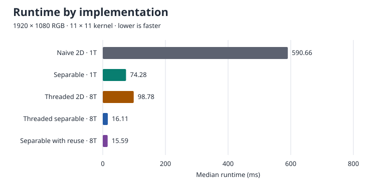
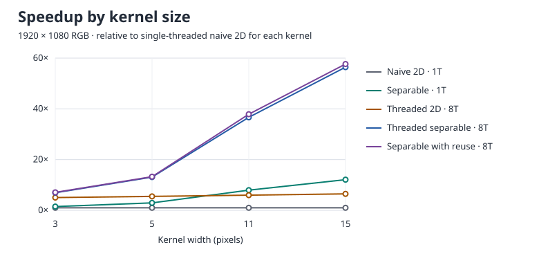

# Gaussian Convolution in C++: From Naive Implementation to Parallel Optimization

## Overview

This project compares five CPU implementations of Gaussian filtering on 8-bit images. The direct 2D convolution provides a reference. Separable filtering reduces the amount of work, row parallelism distributes that work across CPU threads, and a reusable buffer path measures the cost of allocating image storage on each call.

## Why Gaussian convolution?

A Gaussian filter smooths an image by weighting nearby samples according to distance. It reduces high-frequency noise before operations such as edge detection. Applying Gaussians at different values of sigma also provides the smoothed image levels used in scale-space analysis.

## Implementations

| Version | Approach | Main improvement |
| --- | --- | --- |
| 1 | Naive 2D | Direct reference with a square kernel |
| 2 | Separable | Two 1D passes reduce the number of filter taps |
| 3 | Multithreaded 2D | Disjoint row ranges distribute the direct calculation |
| 4 | Multithreaded separable | Combines separability and row parallelism |
| 5 | Separable with buffer reuse | Reuses the output and intermediate buffers across calls |

## How the optimizations work

**Direct 2D.** A filter with side length `K` reads `K²` samples per output pixel and channel. With fixed channel count, work is O(W × H × K²).

**Separable.** For normalized sampled Gaussian weights `g`, the 2D weight at offset `(x, y)` is `g[x] * g[y]`. Both passes together read `2K` samples per pixel and channel. That reduces the work to O(W × H × K), from 225 to 30 taps per channel at K = 15. The horizontal pass writes floating-point samples. The vertical pass reads them and quantizes the final output once. All methods replicate the nearest edge sample outside the image and round the clamped output to the nearest 8-bit value, with ties rounded up.

**Row parallelism.** Threads share the read-only input and write contiguous, disjoint output row ranges. Any leftover rows are distributed one per range until assigned. The calling thread handles one range while the remaining ranges run on `std::thread` workers. Joining the first pass makes its intermediate rows available to every worker in the second pass. One thread uses the calling thread directly. The library rejects nonpositive counts and caps the number of ranges at the image height.

**Memory work.** The original implementations initialized temporary images by copying the source. The current implementations allocate fresh output storage. Separable filtering still traverses an additional full-size intermediate, using four bytes per channel sample. Reusing both buffers removes per-call image-buffer allocation and initialization after setup. It still performs the same two passes, launches the same workers, and moves the same pixel samples.

## Performance results

### Original benchmark

The supplied implementation built with both stb headers already present. A [fresh baseline run](results/original-512.csv) used a 512 × 512 RGB resize, two warmups and five timed runs. The original direct method averaged 5.70, 13.81 and 82.82 ms at K = 3, 5 and 11. The original implementation truncated the horizontal result to 8 bits before the vertical pass. The [supplied historical CSV](results/original-historical.csv) is also preserved. These runs used different inputs and timing summaries from the final sweep. The legacy GB/s column estimated input and output buffer traffic.

### Reproducible sweep

The runner generates deterministic RGB inputs at 512 × 512, 1024 × 1024, 1920 × 1080 and 3840 × 2160. It tests kernels of 3, 5, 11 and 15 with sigma = K / 6. The parallel variants use 1, 2, 4 and 8 threads where the host reports sufficient logical CPUs. Each configuration has two warmups and five timed runs. The starting configuration rotates across rounds to distribute ordering effects.

`std::chrono::steady_clock` times the convolution calls. Input creation, image I/O, kernel generation, reference comparisons and final output destruction sit outside the timing window. Versions 1 through 4 include output allocation, and versions 2 and 4 also include intermediate allocation. Version 5 uses buffers prepared before the timer. Thread launch and joining are included for every parallel run.

The [full CSV](results/benchmark.csv) reports mean, median, minimum and population standard deviation in milliseconds. Throughput and speedup use the median. Speedup divides the single-threaded naive median by the method median for the same resolution and kernel. The error columns compare each method's first warmup output with the naive result.

| Measurement environment | Value |
| --- | --- |
| CPU | Apple M3 Pro |
| Logical CPUs | 12 (6 performance cores and 6 efficiency cores) |
| Operating system | macOS 27.2 (26B123), arm64 |
| Compiler | Apple Clang 21.0.0 (clang-2100.4.1.1) |
| Configuration | Release-equivalent standalone C++17 build, `-O3 -DNDEBUG -pthread` |

| Resolution | Kernel | Method | Threads | Median (ms) | Speedup |
| --- | --- | --- | ---: | ---: | ---: |
| 1920 × 1080 | 11 × 11 | Naive 2D | 1 | 590.66 | 1.00× |
| 1920 × 1080 | 11 × 11 | Separable | 1 | 74.28 | 7.95× |
| 1920 × 1080 | 11 × 11 | Multithreaded 2D | 2 | 314.58 | 1.88× |
| 1920 × 1080 | 11 × 11 | Multithreaded 2D | 4 | 163.90 | 3.60× |
| 1920 × 1080 | 11 × 11 | Multithreaded 2D | 8 | 98.78 | 5.98× |
| 1920 × 1080 | 11 × 11 | Multithreaded separable | 8 | 16.11 | 36.66× |
| 1920 × 1080 | 11 × 11 | Separable with buffer reuse | 8 | 15.59 | 37.89× |

The largest measured speedup was 66.60× at 3840 × 2160 with a 15 × 15 kernel and eight threads. The reused-buffer path took 73.45 ms, and the allocating path took 74.11 ms for a 66.00× speedup. The naive median was 4,891.76 ms.


## Performance charts





## Visual results

The synthetic RGB pattern combines hard edges, narrow stripes and deterministic grain. The result uses a 15 × 15 Gaussian with sigma 2.5 and four threads.

| Original | Blurred |
| --- | --- |
|  |  |

## Build instructions

CMake 3.16 or newer and a C++17 compiler are required. The stb headers are bundled.

```sh
cmake -S . -B build -DCMAKE_BUILD_TYPE=Release
cmake --build build --config Release
```

## Usage

```sh
./build/gaussian_bench blur assets/input/pattern.png results/examples/pattern-blur.png 15 2.5 4 separable_threaded
./build/gaussian_bench benchmark results/benchmark.csv 5 2 4k
node scripts/generate_benchmark_charts.mjs results/benchmark.csv results/charts
```

The `blur` arguments are input path, output PNG path, kernel side, sigma, thread count and method. Sigma defaults to K / 6, the thread count defaults to 1 and the method defaults to `separable_threaded`. Method names are `naive_2d`, `separable`, `threaded_2d`, `separable_threaded` and `separable_reuse`. Buffer reuse applies to repeated calls through the library API or benchmark runner. A single `blur` command still prepares its buffers.

The benchmark defaults to five runs, two warmups and `standard`, which runs through 1920 × 1080. The `quick` mode limits the sweep to 512 × 512. Node.js is only required to regenerate the SVG charts. With multi-configuration CMake generators, executables are typically in `build/Release`.

## Testing

```sh
ctest --test-dir build -C Release --output-on-failure
```

The C++ test executable checks normalized symmetric kernels, invalid sizes and sigma values, boundary samples, output dimensions and input immutability. Cases include constant images, a grayscale impulse, an RGB pattern, a 1 × 1 image and kernels larger than the input. The suite compares with independent double-precision direct convolution and checks threaded output across uneven partitions and thread counts above the row count. The tolerance is at most one intensity level of maximum error and 0.05 mean absolute error per channel sample. Equivalent single-threaded and multithreaded paths must match exactly.

## Technical observations

- **Kernel size.** At 1920 × 1080, the naive median rose from 43.11 ms at K = 3 to 1,228.57 ms at K = 15. Single-threaded separability went from 1.49× to 12.09× speedup as the gap between K² and 2K grew.
- **Thread scaling.** At 1920 × 1080 and K = 11, direct convolution improved from 314.58 ms with two threads to 163.90 ms with four and 98.78 ms with eight. Threaded separable filtering went from 20.13 ms at four threads to 16.11 ms at eight, a 1.25× gain. Each parallel configuration improved through eight threads. Higher counts were outside this sweep. Worker creation and barrier costs take a larger fraction of runtime on smaller jobs.
- **Buffer reuse.** At 1920 × 1080, K = 11 and eight threads, reuse reduced the median from 16.11 to 15.59 ms, about 3.2%. At 512 × 512 and K = 11 it was about 1.0% slower in the recorded run. Short allocation and scheduling differences can be comparable to the effect being measured. The reusable intermediate occupies about 95 MiB at 4K RGB.
- **Precision.** Retaining floating-point intermediates avoids quantization between passes. Different accumulation order can move a final sample across a rounding threshold. The CSV records this difference in final 8-bit intensity levels.

## Limitations

The implementation is CPU-only. Results depend on the available cores, memory subsystem, compiler and system load. The image path works on decoded 8-bit samples and writes PNG. Bundled stb readers include PNG, JPEG, BMP and TGA. Channels are filtered independently, including alpha when present. The sole boundary policy is edge replication.

The vendored [stb headers](https://github.com/nothings/stb) are `stb_image.h` v2.30 and `stb_image_write.h` v1.16. Their embedded MIT and public-domain licensing alternatives are preserved.
